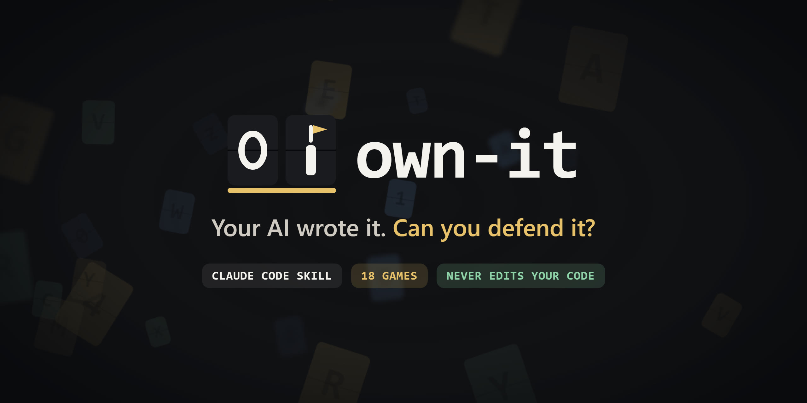
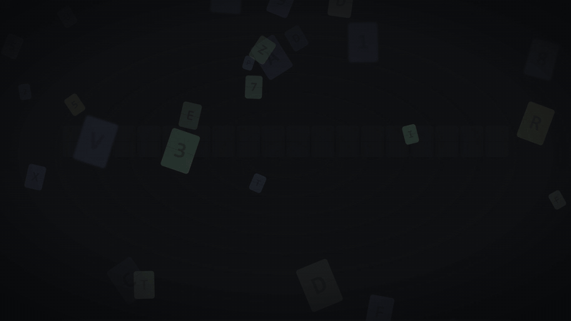
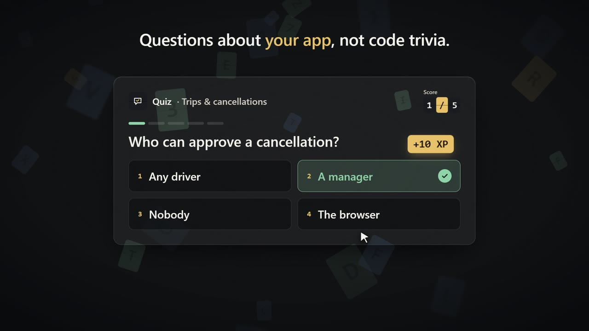
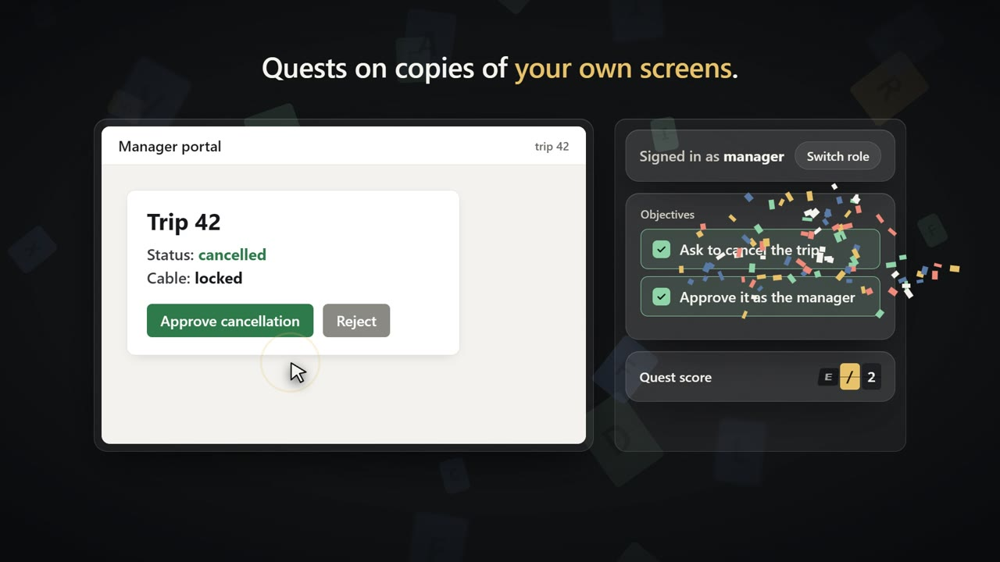
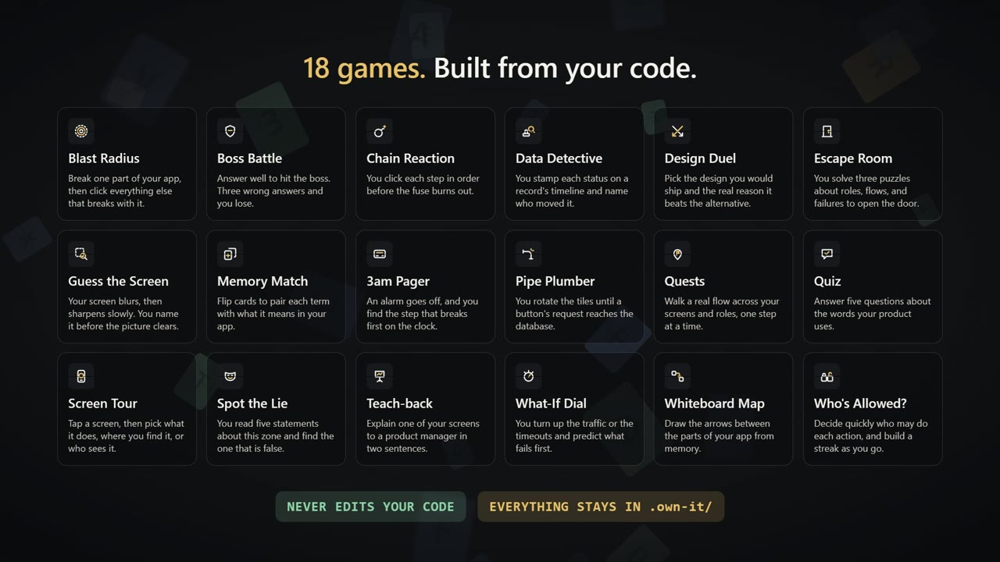

<p align="center">
  
</p>

<p align="center">
  <b>A Claude Code skill that turns your own codebase into games.</b><br>
  Play them to prove you can explain, trace and defend the code your AI wrote.
</p>

<p align="center">
  
  
  
  
  
  
</p>

<p align="center">
  <a href="docs/media/own-it-promo.mp4">
    
  </a>
  <br>
  <sub>▶ <a href="docs/media/own-it-promo.mp4">Watch the 30-second video with sound</a></sub>
</p>

---

## Why

AI writes a lot of our code now. It ships, it works, and a month later nobody can explain how. own-it is built on the "whiteboard defense" idea: you should be able to explain any system you shipped, defend the decisions behind it, and say where it fails.

You don't need to remember line numbers. You do need to answer:

- *Who is allowed to do this, and why?*
- *What happens when this service is down at 3am?*
- *Why this design and not the obvious alternative?*

own-it reads your repo, splits it into **zones** (Trips, Payments, Auth…), and builds games from what it finds: your app's own words, flows, roles and screens.

## Built to be cheap

Most AI study tools burn tokens on every question. own-it doesn't: **the game runs in your browser, not in the chat.**

| | Tokens |
|---|---|
| While you play a round in the page | **0**: the page scores it itself, and Claude only wakes for results |
| Building one quiz round | **~1,100** |
| A full session of 6 rounds, with grading and feedback | **~10,400** |
| Reading a zone's code (once, cached afterwards) | capped at 30k, **~1,500** on the sample app |

<sub>Measured in the v2 end-to-end run on the bundled sample app. Big codebases cost more to read once, and the same per round.</sub>

How:

- **A script does the chores.** A zero-dependency Node helper scans, validates, derives answers, shuffles, scores and saves progress. Claude never spends tokens on mechanical work.
- **Claude writes only small data.** Each game is a ready-made template, and Claude fills in a short JSON round instead of writing a page.
- **Cheap jobs go to cheap models.** Question drafting goes to Haiku and code reading to Sonnet. Your main model is kept for grading and the boss.
- **Docs load only when needed.** The skill is split into small files Claude reads one phase at a time, each with a word budget the tests enforce.

## How it plays

```
/own-it
```

1. **One check.** Claude asks once whether this is a fresh or forked session, because the game reads a lot of code.
2. **One notice.** Everything own-it creates goes in `.own-it/` inside your project. Delete that folder and it's all gone.
3. **Your dashboard opens.** It's a local page with games picked for *your* app. The page talks to Claude through a live link on your own machine (127.0.0.1 only).
4. **Pick a game, pick a level.** Claude builds the round and the page plays it. You get a score, XP and a debrief, and Claude grades anything you type.

<table>
  <tr>
    <td width="33%"></td>
    <td width="33%"></td>
    <td width="33%"></td>
  </tr>
  <tr>
    <td align="center"><sub><b>Quiz</b>: about your product, not code trivia</sub></td>
    <td align="center"><sub><b>Quests</b>: on copies of your own screens</sub></td>
    <td align="center"><sub><b>20 games</b>, built from your code</sub></td>
  </tr>
</table>

### Levels

Each time you open a game, you choose how deep it goes:

| Level | For you if… | Hints |
|---|---|---|
| **Easy** | you don't know the program at all | free |
| **Medium** | you know some parts | 15 XP |
| **Hard** | you know it inside out (starts in Exam mode) | 30 XP |
| **Impossible** | you want an all-out test of rare behaviour: retries, timeouts, partial failures | off, timer on |
| **Other** | you describe what you know, e.g. *"I built checkout, never touched admin"* | matched to the closest level |

**Practice** gives hints and debriefs. **Exam** gives a report card per zone: *defensible*, *shaky* or *blind spot*.

## The games

Each zone has a ladder: **Words → Map → Trace → Break → Boss**. Claim every rung to own the zone. When the code changes later, **fog** rolls back over it until you replay what changed.

| | Game | Rung | What you do |
|:-:|---|---|---|
|  | **Quiz** | Words | Answer five questions about the words your product uses. |
|  | **Memory Match** | Words | Flip cards to pair each term with what it means in your app. |
|  | **Spot the Lie** | Words | Read five statements about a zone and find the false one. |
|  | **Whiteboard Map** | Map | Draw the arrows between the parts of your app from memory. |
|  | **Screen Tour** | Map | Pick what a screen does, where you find it, or who sees it. |
|  | **Guess the Screen** | Map | A screen blurs, then slowly sharpens. Name it before it clears. |
|  | **Blast Radius** | Map | Break one part, then click everything else that breaks with it. |
|  | **Quests** | Trace | Walk a real flow across your screens and roles, one step at a time. |
|  | **Chain Reaction** | Trace | Click each step in order before the fuse burns out. |
|  | **Data Detective** | Trace | Stamp each status on a record's timeline and name who moved it. |
|  | **Next Tick** | Trace | One frozen moment of your app. Predict what happens next, tick by tick. |
|  | **Pipe Plumber** | Trace | Rotate tiles until a button's request reaches the database. |
|  | **Who's Allowed?** | Trace | Decide fast who may do each action, and build a streak. |
|  | **3am Pager** | Break | An alarm goes off. Find the step that broke first, on the clock. |
|  | **What-If Dial** | Break | Turn up traffic or timeouts and predict what fails first. |
|  | **Design Duel** | Break | Pick the design you'd ship and the real reason it beats the other. |
|  | **Case File** | Break | A bug report lands as a case. Pick the real clues, accuse the guilty part, explain why. |
|  | **Boss Battle** | Boss | Answer well to hit the boss. Three wrong answers and you lose. |
|  | **Escape Room** | Boss | Solve three puzzles about roles, flows and failures to open the door. |
|  | **Teach-back** | Bonus | Explain one of your screens to a product manager in two sentences. |

Most games play from the keyboard, and the dashboard has sound effects, confetti and chill ambient music, which you can mute.

Also in the box:

- **Where this lives in your code.** After every round you get the `file:line` behind each answer, one click from your editor.
- **Guided tutorials.** Every game has a How to play card, and the trickier ones (Blast Radius, Pipe Plumber, What-If Dial, Chain Reaction) have a short guided practice board. A first-visit tour explains the dashboard and the difference between Practice and Exam.
- **A secret level.** If Claude notices a real bug while reading a zone, a hidden option appears in the Quests picker. Find the bug on a safe copy of your screens, then get the case report with its `file:line`. own-it still never touches your code.

## Principles

- **Never edits your code.** own-it writes only inside `.own-it/`, even if you ask it to fix something mid-game. If it spots a bug, it tells you.
- **Screens are safe copies.** Quests run on sanitized rebuilds of your screens with fake data. They have no login, no backend and no scripts, and run in a locked-down frame.
- **Token-lean.** About 1k tokens per round and 0 while you play. See [Built to be cheap](#built-to-be-cheap).
- **Spoiler-safe.** Answers are hidden in the page data and only revealed when you act.

## Install

Requirements: [Claude Code](https://claude.com/claude-code), Node.js 18+, and a desktop browser. If Node is missing, the skill offers to install a pinned LTS version and checks its checksum first.

Clone the repo and copy the `own-it/` folder into your Claude Code skills directory:

```bash
git clone https://github.com/abdazez01/own-it.git
cp -r own-it/own-it ~/.claude/skills/own-it
```

Then, in any project, start a fresh or forked session and run `/own-it`, or just say *"quiz me on my code"*.

Progress lives in `.own-it/` in your project. It's gitignored by default, but you can commit it to share coverage with your team.

## Repository layout

```
own-it/                 the skill (this is what you install)
  SKILL.md              entry point
  references/           instructions Claude loads only when needed
  scripts/own-it.mjs    zero-dependency helper CLI
  assets/               dashboard, engine, 20 game templates, brand
tests/                  node:test suite (npm test)
fixtures/               sample app for end-to-end runs
docs/                   design specs, plans, run reports, media
```

## Development

```bash
npm test
```

No dependencies to install. The suite covers every helper command, the browser engine (on a fake DOM), all 20 games, security rules, layout and the docs' word budgets.

## License

[MIT](LICENSE) © abdazez01
